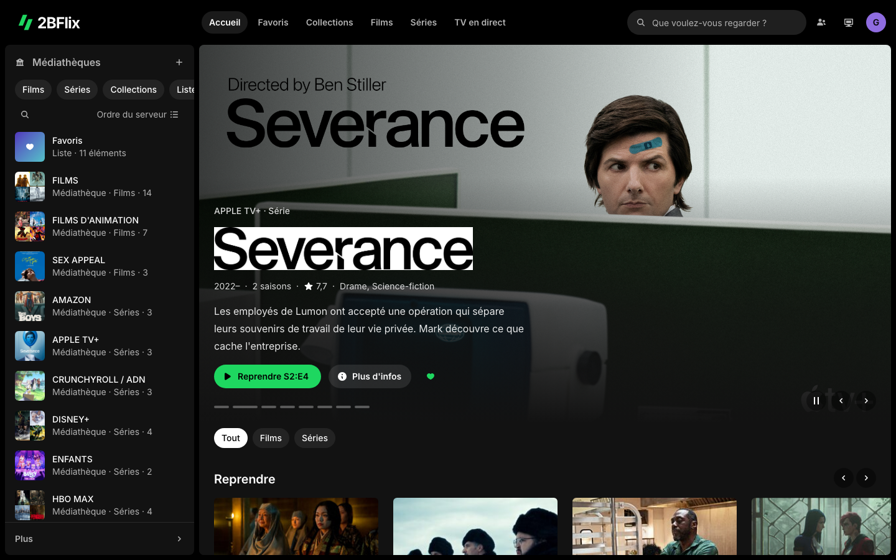
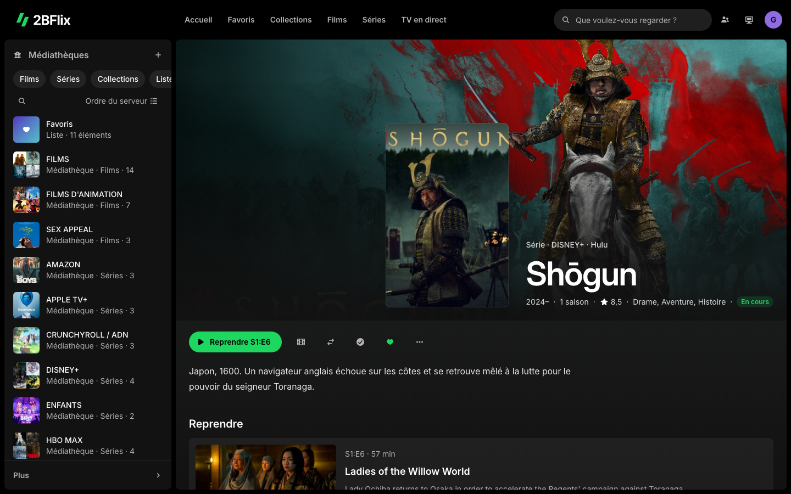
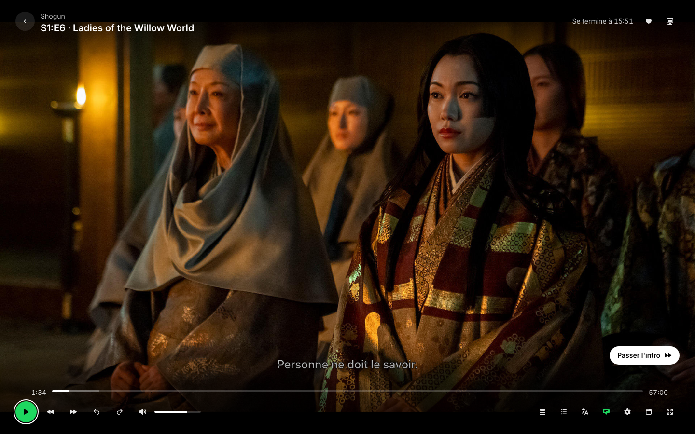

# 2BFlix Groove

Thème pour Jellyfin 12 : la direction artistique de Spotify (noir profond, vert d'action, formes en pilule, couleur tirée de l'affiche) avec l'expérience de Netflix (bannière, rangées horizontales, fiches riches, lecteur plein écran).



## Contenu du dépôt

| Dossier | Rôle |
| --- | --- |
| `mockup/` | Maquette interactive autonome (HTML, Tailwind, JS) avec de vraies données. Elle sert de référence visuelle et fonctionnelle. |
| `theme/` | Le thème Jellyfin : CSS personnalisé et script injecté. En cours de développement. |
| `tools/` | Scripts qui régénèrent les données de la maquette (`data.js`) et les icônes (`icons.js`). |
| `docs/` | Captures d'écran. |

## Ouvrir la maquette

Ouvrez `mockup/index.html` dans un navigateur. Aucune installation n'est nécessaire, mais une connexion Internet est requise (Tailwind, polices et images sont chargés en ligne).

La maquette couvre les écrans de Jellyfin web :

- connexion (choix du profil, connexion manuelle, Quick Connect) ;
- accueil (Spotlight et sections de Home Screen Sections) ;
- médiathèques (onglets, tri, filtres, A-Z, affiches, vignettes ou liste) ;
- fiches film, série, saison, épisode, collection, liste de lecture et personne ;
- favoris, collections, listes de lecture ;
- TV en direct (programmes, guide, chaînes, enregistrements, planifications) ;
- recherche, préférences, télécommande ;
- lecteur (chapitres, aperçu de la barre de progression, « Passer l'intro », épisode suivant, pistes audio et sous-titres, qualité, vitesse, statistiques, lecture sur un autre appareil).

| Fiche série | Lecteur |
| --- | --- |
|  |  |

## Régénérer les données

```sh
node tools/build-data.mjs mockup/data.js
node tools/build-icons.mjs mockup/icons.js
```

Sources : [TVmaze](https://www.tvmaze.com/api) pour les séries, l'API REST de Wikipédia pour les films, les personnes et les chaînes. Les icônes sont les [Heroicons](https://heroicons.com) Micro (MIT).

## Données de la maquette

Les affiches, photos, titres et distributions sont réels. L'historique de lecture, les versions et pistes des fichiers, le guide TV et les enregistrements sont simulés. Les résumés d'épisodes viennent de TVmaze et sont en anglais.

## Licence

MIT pour le code. Les affiches et photos restent la propriété de leurs ayants droit : la maquette les charge depuis leurs sources, et les captures de `docs/` ne servent qu'à illustrer le thème.
